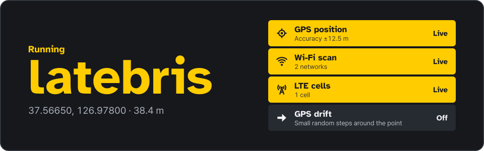
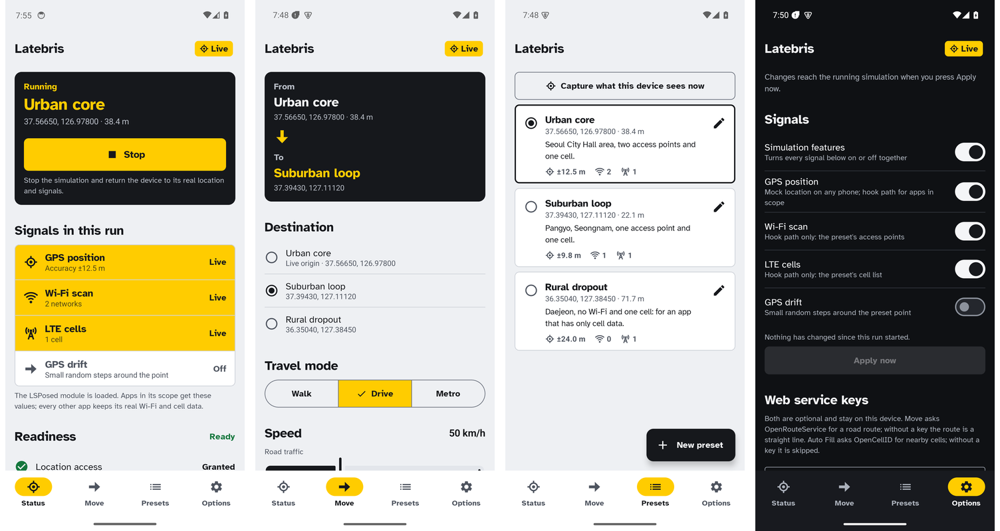
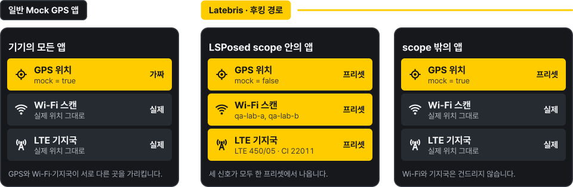
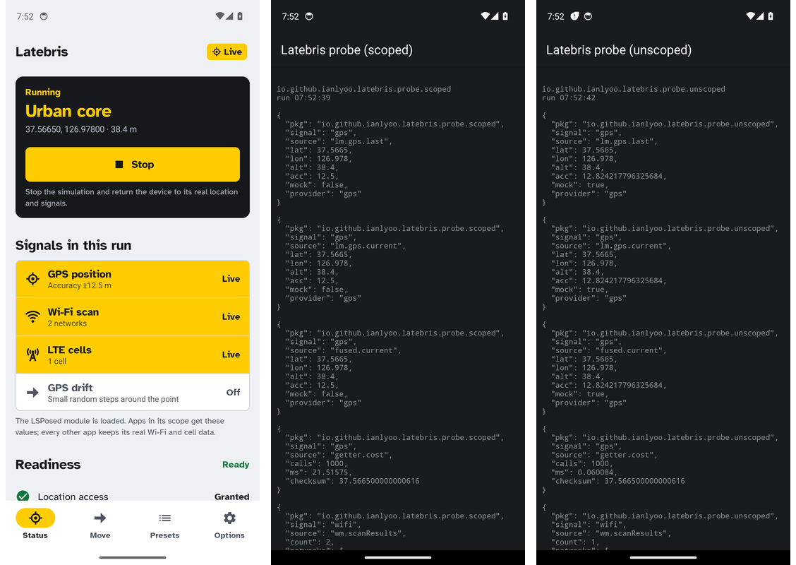

<p align="center">
  <picture>
    <source media="(max-width: 700px)" srcset="docs/assets/readme/hero-narrow.svg">
    
  </picture>
</p>

<p align="center">
  <b>한 장소를 통째로 재생하는 안드로이드 앱. GPS, Wi-Fi 스캔, LTE 기지국을 한 프리셋으로.</b><br>
  루팅 + LSPosed 환경에서는 고른 앱만 세 신호를 모두 받고, 나머지 앱은 실제 Wi-Fi와 기지국을 그대로 봅니다.
</p>

<p align="center">
  <a href="LICENSE"><picture><source media="(prefers-color-scheme: dark)" srcset="https://img.shields.io/badge/license-MIT-F1F2F4?style=flat-square&labelColor=2B3038"></picture></a>
  <a href="https://github.com/ianlyoo/latebris/releases/latest"><picture><source media="(prefers-color-scheme: dark)" srcset="https://img.shields.io/github/v/release/ianlyoo/latebris?style=flat-square&label=release&labelColor=2B3038&color=FFCC00"></picture></a>
  <a href="https://github.com/ianlyoo/latebris/actions/workflows/ci.yml"><picture><source media="(prefers-color-scheme: dark)" srcset="https://img.shields.io/github/actions/workflow/status/ianlyoo/latebris/ci.yml?branch=main&style=flat-square&label=CI&labelColor=2B3038&color=F1F2F4"></picture></a>
  <a href="#설치"><picture><source media="(prefers-color-scheme: dark)" srcset="https://img.shields.io/badge/Android-12%2B%20%C2%B7%20API%2031%2B-F1F2F4?style=flat-square&labelColor=2B3038"></picture></a>
  <a href="#소스에서-빌드"><picture><source media="(prefers-color-scheme: dark)" srcset="https://img.shields.io/badge/Kotlin-Jetpack%20Compose-F1F2F4?style=flat-square&labelColor=2B3038"></picture></a>
  <a href="#일반-mock-gps-앱과-무엇이-다른가"><picture><source media="(prefers-color-scheme: dark)" srcset="https://img.shields.io/badge/LSPosed-module-F1F2F4?style=flat-square&labelColor=2B3038"></picture></a>
</p>

<p align="center">
  <a href="README.md">English</a> · <b>한국어</b>
  &nbsp;&nbsp;|&nbsp;&nbsp;
  <a href="https://github.com/ianlyoo/latebris/releases/latest">릴리스</a> ·
  <a href="https://ianlyoo.github.io/latebris/">프로젝트 페이지</a> ·
  <a href="docs/VERIFICATION.md">검증 기록</a> ·
  <a href="docs/LIMITATIONS.md">한계</a>
</p>

<br>

<p align="center">
  
</p>
<p align="center">
  <sub>공항 안내 표지판처럼 그린 Latebris 0.3.0. 노란색은 지금 살아 있는 값에만 씁니다.<br>Status · Move · Presets · Options (다크 모드)</sub>
</p>

Latebris는 위치에 따라 동작이 달라지는 기능을 시험하는 안드로이드 앱입니다. 프리셋 하나에 GPS 좌표, Wi-Fi 스캔에 잡히는 공유기 목록, 휴대폰이 보고하는 LTE 기지국 목록이 함께 들어 있습니다. **Start**를 누르면 그 장소가 재생되고, **Stop**을 누르면 기기가 다시 실제 신호를 읽습니다. 본인 기기와 테스트 권한이 있는 앱에서만 쓰세요.

## 일반 Mock GPS 앱과 무엇이 다른가

일반 Mock GPS 앱은 **개발자 옵션 → 모의 위치 앱 선택**에서 고르는 그 앱입니다. 바꾸는 신호는 GPS 하나뿐이고, 기기의 모든 앱에 한꺼번에 적용되며, 안드로이드는 그 위치에 모의 위치 표시(`Location.isMock()`)를 붙입니다. Wi-Fi 스캔과 기지국 목록은 여전히 휴대폰이 실제로 있는 곳을 가리킵니다. 그래서 GPS를 이 두 신호와 맞춰 보는 앱에는 한 기기가 두 곳에 동시에 있는 것으로 보입니다.

Latebris는 세 신호를 한 프리셋에서 함께 재생합니다. **후킹 경로**에서는 LSPosed scope에 넣은 앱 안에서만, 모의 위치 표시 없이 내보냅니다. 그 밖의 앱은 실제 Wi-Fi와 기지국을 그대로 봅니다.

<p align="center">
  <picture>
    <source media="(max-width: 700px)" srcset="docs/assets/readme/compare-narrow.ko.svg">
    
  </picture>
</p>

| | 일반 Mock GPS 앱 | Latebris · 순정 경로 | Latebris · 후킹 경로 |
|---|---|---|---|
| **필요한 것** | 개발자 옵션 | Android 12 이상, 개발자 옵션 | 루팅: Magisk, Zygisk, LSPosed |
| **적용 범위** | 모든 앱 | 모든 앱 | LSPosed scope 안의 앱만 |
| **GPS** | 가짜 위치 · `mock = true` | 프리셋 위치 · `mock = true` | 프리셋 위치 · **`mock = false`** |
| **Wi-Fi 스캔** | 실제 값 | 실제 값 | **프리셋 공유기 목록** |
| **LTE 기지국** | 실제 값 | 실제 값 | **프리셋 LTE 기지국** |
| **scope 밖의 앱** | — | — | 실제 Wi-Fi와 기지국, GPS는 모의 위치 표시 |
| **검증한 환경** | — | Android 15 에뮬레이터 (API 35) | Android 14 에뮬레이터 (API 34), Magisk 26.4, LSPosed 1.9.2 |

> [!NOTE]
> 루팅하지 않으면 Latebris도 여느 모의 위치 앱과 같습니다. GPS만 바뀌고 모의 위치 표시가 붙습니다. 후킹 경로라고 들키지 않는 것도 아닙니다. 루팅, Magisk, LSPosed는 감지할 수 있고, scope 밖의 앱에는 여전히 모의 위치 표시가 붙은 위치가 보입니다. 방어하는 쪽이 알아내는 방법은 [LIMITATIONS.md](docs/LIMITATIONS.md#how-a-defender-can-detect-latebris)에 정리해 두었습니다.

## 루팅 에뮬레이터에서 잰 값

위 비교는 짐작이 아니라 측정한 결과입니다. 따로 만든 프로브 앱(`probe/`)은 보통 앱이 쓰는 공개 API로 위치, Wi-Fi, 기지국을 읽습니다. 루팅한 Android 14 에뮬레이터에 이 앱을 두 벌 깔아 하나는 LSPosed scope 안에, 하나는 밖에 두고, *Urban core* 프리셋을 켠 채로 읽었습니다.

<p align="center">
  
</p>
<p align="center">
  <sub>왼쪽: Urban core가 켜진 Latebris. 가운데: scope 안 프로브, <code>mock: false</code>. 오른쪽: scope 밖 프로브, <code>mock: true</code>.</sub>
</p>

| 읽은 값 | scope 안 프로브 | scope 밖 프로브 |
|---|---|---|
| GPS (`getCurrentLocation`, fused) | **37.5665, 126.9780 · mock = false** | 37.5665, 126.9780 · mock = true |
| Wi-Fi 스캔 | **`qa-lab-a`, `qa-lab-b`** (프리셋) | `AndroidWifi` (에뮬레이터 자체 공유기) |
| 서빙 기지국 | **LTE 450/05, CI 22011, PCI 101, TAC 101** (프리셋) | LTE 310/260, CI 47108 (에뮬레이터 자체 기지국) |

**Stop**을 누르자 두 프로브 모두 실제 좌표(48.8584, 2.2945)와 에뮬레이터 자체 Wi-Fi, 기지국으로 돌아왔습니다. 0.3.0 빌드로 두 에뮬레이터에서 같은 과정을 다시 돌렸고, 값은 모두 같았습니다. 실행 중에 Latebris가 강제 종료되면 어떻게 되는지까지, 단계별 기록은 [docs/VERIFICATION.md](docs/VERIFICATION.md)에 있습니다.

## 앱에 들어 있는 것

| | 하는 일 | 어디까지 확인했나 |
|---|---|---|
| **Presets** | 프리셋 하나에 좌표(고도, 정확도 포함), Wi-Fi 공유기(SSID, BSSID, 신호 세기, 주파수, 보안 방식), LTE 기지국(MCC, MNC, TAC, CI, PCI, EARFCN)을 담습니다. Urban core, Suburban loop, Rural dropout 세 개가 기본으로 들어 있습니다. | Urban core로 두 경로의 에뮬레이터 검증 전체를 돌렸습니다 |
| **Start / Stop** | Status 표지판의 버튼 하나. Stop을 누르면 두 경로 모두 실제 값으로 돌아옵니다. | 에뮬레이터, 두 경로 모두 |
| **Move** | 현재 위치에서 저장된 목적지까지 정한 속도로 이동합니다. 키가 없으면 직선으로, 본인의 OpenRouteService 키가 있으면 도로 경로로 움직입니다. | 직선 이동은 API 35 에뮬레이터에서 확인: 시속 50 km 설정에서 18초에 246 m (초속 13.7 m, 설정값 13.9 m). 도로 경로는 단위 테스트로만 확인 |
| **Capture** | 기기가 지금 보는 좌표, Wi-Fi 스캔, 기지국을 새 프리셋으로 저장합니다. | 에뮬레이터에서는 돌려 보지 않음 |
| **Auto Fill** | 본인의 OpenCellID 키로 프리셋 주변 기지국을 찾아 채웁니다. | 단위 테스트로만 확인 |
| **Status** | 권한, LSPosed 모듈이 올라왔는지, 어떤 신호가 살아 있는지를 한눈에 보여 줍니다. | 루팅 에뮬레이터에서 "LSPosed module: Active", 순정 에뮬레이터에서 "Not active" |

## 설치

[릴리스](https://github.com/ianlyoo/latebris/releases/latest)에서 <b><code>latebris-0.3.0.apk</code></b>를 받습니다.

> [!IMPORTANT]
> **0.1.x 버전이 깔려 있다면 먼저 지워 주세요.** 0.2.0부터 패키지 이름이 `com.example.gpstick`에서 `io.github.ianlyoo.latebris`로 바뀌었습니다. 옛 버전을 지우지 않으면 두 앱이 나란히 설치된 채 같은 신호를 건드립니다.

<details open>
<summary><b>순정 경로</b> · Android 12 이상, 루팅 없이</summary>
<br>

1. APK를 설치하고 위치와 알림 권한을 허용합니다.
2. **개발자 옵션 → 모의 위치 앱 선택 → Latebris**를 고릅니다.
3. 프리셋을 고르고 **Start**를 누릅니다. **Stop**을 누르면 기기가 실제 위치로 돌아갑니다.

</details>

<details open>
<summary><b>후킹 경로</b> · Magisk, Zygisk, LSPosed로 루팅한 기기</summary>
<br>

순정 경로 설정을 마친 뒤:

1. LSPosed에서 Latebris 모듈을 켜고, 테스트할 앱을 scope에 넣습니다.
2. 기기를 재부팅합니다. 저희 테스트에서 LSPosed 1.9.2는 scope를 바꾼 뒤 재부팅해야 적용했습니다.
3. 모듈이 올라오면 Status 화면에 **LSPosed module: Active**가 보입니다.

</details>

Move의 도로 경로에는 본인의 OpenRouteService 키가, Auto Fill에는 OpenCellID 키가 필요합니다. Options 화면에 입력하면 기기 안에만 저장됩니다. 처음 쓰신다면 [초기 세팅 가이드](How_to_setup_stock_android.md)와 [사용 방법](How_to_use.md)을 차례로 보세요.

## 소스에서 빌드

JDK 17과 Android SDK(플랫폼 35)가 필요합니다.

```bash
./gradlew assembleDebug testDebugUnitTest

# 계측 테스트는 숨은 API 객체를 리플렉션으로 만들기 때문에 먼저 아래를 켭니다.
adb shell settings put global hidden_api_policy 1
./gradlew connectedDebugAndroidTest
```

`probe` 모듈은 프로브 앱을 `scoped`, `unscoped` 두 가지로 빌드하고, `tools/verify-emulator.sh`가 에뮬레이터에서 전체 확인을 한 번에 돌립니다. 자세한 방법은 [docs/VERIFICATION.md](docs/VERIFICATION.md#reproduce)에 있습니다.

<details>
<summary>빌드할 때 넣는 키와 릴리스 서명</summary>
<br>

선택 사항인 키는 Gradle 속성이나 환경 변수 `OPEN_ROUTE_SERVICE_API_KEY`, `OPEN_CELL_ID_API_KEY`로 넣습니다. 릴리스 서명은 `ANDROID_SIGNING_STORE_FILE`, `ANDROID_SIGNING_STORE_PASSWORD`, `ANDROID_SIGNING_KEY_ALIAS`, `ANDROID_SIGNING_KEY_PASSWORD`를 읽습니다.

</details>

## 한계와 사용 범위

- **아직 에뮬레이터에서만 확인했습니다.** 후킹 경로는 Android 14(API 34), Magisk 26.4, LSPosed 1.9.2에서, 순정 경로는 Android 15(API 35)에서 돌렸습니다. 실제 휴대폰과 다른 Android, LSPosed 버전은 확인하지 않았습니다.
- **다루지 않는 신호:** 5G NR, WCDMA, GSM 기지국, 지금 연결된 Wi-Fi 정보, GNSS 위성 상태와 NMEA, 원시 측정값.
- **실행 중에 Latebris가 종료되면** 후킹한 Wi-Fi와 기지국 값은 10초 안팎에 실제 값으로 돌아오지만, GPS는 Latebris를 다시 열 때까지 마지막 가짜 위치에 머뭅니다. 안드로이드가 종료된 앱의 모의 위치 제공자를 그대로 두기 때문입니다.

전체 목록과 방어하는 쪽이 Latebris를 알아내는 방법은 [docs/LIMITATIONS.md](docs/LIMITATIONS.md)에 있습니다.

**Latebris는 본인 기기와 테스트 권한이 있는 앱에서만 쓰세요.**

## 라이선스

[MIT](LICENSE). 앱에는 Atkinson Hyperlegible 글꼴이 들어 있고, 이 페이지의 그림에는 Pretendard도 썼습니다. 두 글꼴 모두 SIL Open Font License 1.1을 따릅니다.

<p align="center">
  <sub><i>Latebris</i>: 라틴어로 ‘숨는 곳’.</sub>
</p>
