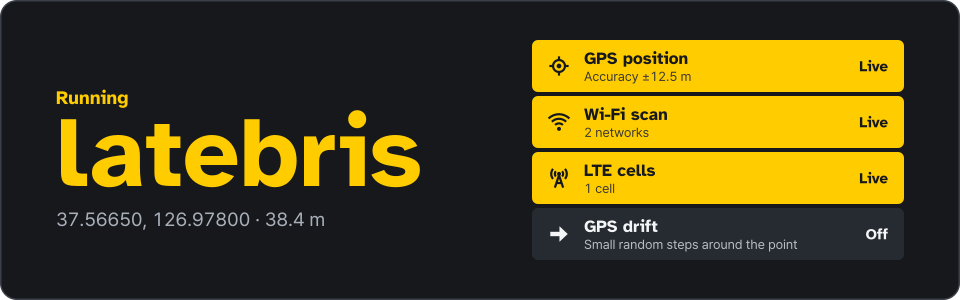
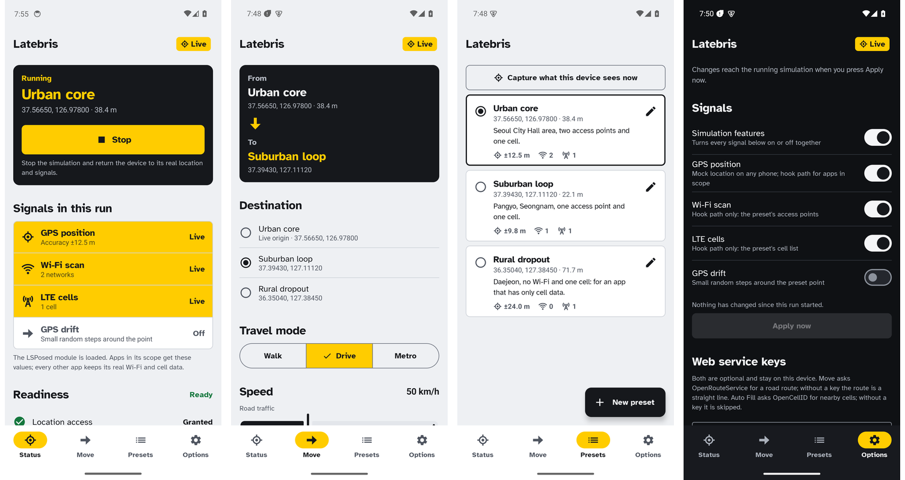
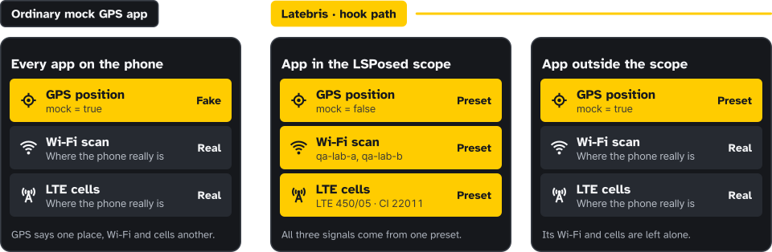
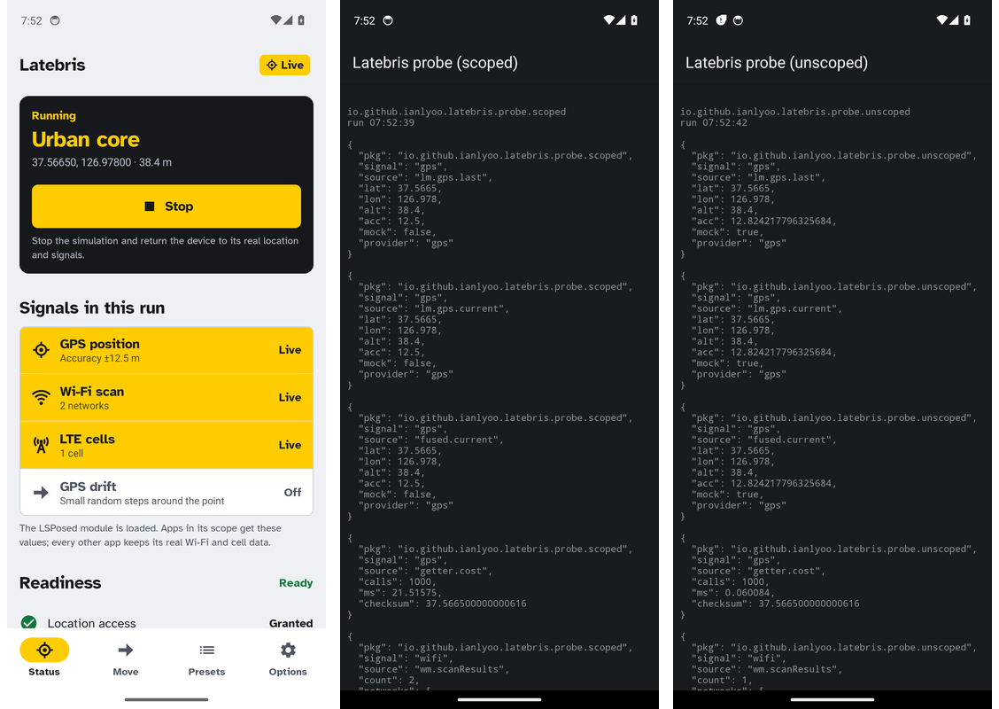

<p align="center">
  <picture>
    <source media="(max-width: 700px)" srcset="docs/assets/readme/hero-narrow.svg">
    
  </picture>
</p>

<p align="center">
  <b>Play back a whole location on Android: GPS, Wi-Fi scan and LTE cells, from one preset.</b><br>
  With root and LSPosed, only the apps you pick see all three. The rest keep their real Wi-Fi and cells.
</p>

<p align="center">
  <a href="LICENSE"><picture><source media="(prefers-color-scheme: dark)" srcset="https://img.shields.io/badge/license-MIT-F1F2F4?style=flat-square&labelColor=2B3038"></picture></a>
  <a href="https://github.com/ianlyoo/latebris/releases/latest"><picture><source media="(prefers-color-scheme: dark)" srcset="https://img.shields.io/github/v/release/ianlyoo/latebris?style=flat-square&label=release&labelColor=2B3038&color=FFCC00"></picture></a>
  <a href="https://github.com/ianlyoo/latebris/actions/workflows/ci.yml"><picture><source media="(prefers-color-scheme: dark)" srcset="https://img.shields.io/github/actions/workflow/status/ianlyoo/latebris/ci.yml?branch=main&style=flat-square&label=CI&labelColor=2B3038&color=F1F2F4"></picture></a>
  <a href="#install"><picture><source media="(prefers-color-scheme: dark)" srcset="https://img.shields.io/badge/Android-12%2B%20%C2%B7%20API%2031%2B-F1F2F4?style=flat-square&labelColor=2B3038"></picture></a>
  <a href="#build-from-source"><picture><source media="(prefers-color-scheme: dark)" srcset="https://img.shields.io/badge/Kotlin-Jetpack%20Compose-F1F2F4?style=flat-square&labelColor=2B3038"></picture></a>
  <a href="#how-it-differs-from-an-ordinary-mock-gps-app"><picture><source media="(prefers-color-scheme: dark)" srcset="https://img.shields.io/badge/LSPosed-module-F1F2F4?style=flat-square&labelColor=2B3038"></picture></a>
</p>

<p align="center">
  <b>English</b> · <a href="README.ko.md">한국어</a>
  &nbsp;&nbsp;|&nbsp;&nbsp;
  <a href="https://github.com/ianlyoo/latebris/releases/latest">Releases</a> ·
  <a href="https://ianlyoo.github.io/latebris/">Project page</a> ·
  <a href="docs/VERIFICATION.md">Verification</a> ·
  <a href="docs/LIMITATIONS.md">Limitations</a>
</p>

<br>

<p align="center">
  
</p>
<p align="center">
  <sub>Latebris 0.3.0, drawn like an airport sign: yellow marks only what is live.<br>Status · Move · Presets · Options (dark mode)</sub>
</p>

Latebris is an Android app for testing location-dependent features. A preset holds a GPS position, the Wi-Fi access points a scan returns and the LTE cells the phone reports. Press **Start** and Latebris plays that place back; press **Stop** and the device reads its real signals again. Use it on devices you own and apps you are allowed to test.

## How it differs from an ordinary mock GPS app

An ordinary mock GPS app is the one you pick under **Developer options → Select mock location app**. It changes one signal, for every app at once, and Android marks each fix it serves as mock (`Location.isMock()`). The Wi-Fi scan and the cell list still describe where the phone really is, so an app that checks GPS against them sees the phone in two places.

Latebris plays back all three signals from one preset. On the **hook path** it serves them only inside the apps in its LSPosed scope, with the mock flag cleared, and leaves every other app on its real Wi-Fi and cells.

<p align="center">
  <picture>
    <source media="(max-width: 700px)" srcset="docs/assets/readme/compare-narrow.svg">
    
  </picture>
</p>

| | Ordinary mock GPS app | Latebris · stock path | Latebris · hook path |
|---|---|---|---|
| **Needs** | Developer options | Android 12+, Developer options | Root: Magisk, Zygisk and LSPosed |
| **Reaches** | Every app | Every app | Only apps in the LSPosed scope |
| **GPS** | Fake position · `mock = true` | Preset position · `mock = true` | Preset position · **`mock = false`** |
| **Wi-Fi scan** | Real | Real | **Preset access points** |
| **LTE cells** | Real | Real | **Preset LTE cells** |
| **Apps outside the scope** | — | — | Real Wi-Fi and cells; GPS flagged as mock |
| **Verified on** | — | Android 15 emulator (API 35) | Android 14 emulator (API 34), Magisk 26.4, LSPosed 1.9.2 |

> [!NOTE]
> Without root, Latebris is a mock location app like any other: GPS only, flagged as mock. And the hook path is not invisible: root, Magisk and LSPosed can be detected, and apps outside the scope still see a mock-flagged fix. [LIMITATIONS.md](docs/LIMITATIONS.md#how-a-defender-can-detect-latebris) lists how a defender can tell.

## Measured on a rooted emulator

The comparison above was measured, not assumed. A separate probe app (`probe/`) reads location, Wi-Fi and cells through the public APIs any app uses. It was installed twice on a rooted Android 14 emulator, one copy inside the LSPosed scope and one outside it, while the *Urban core* preset ran.

<p align="center">
  
</p>
<p align="center">
  <sub>Left: Latebris with Urban core live. Middle: the probe inside the scope, <code>mock: false</code>. Right: the probe outside it, <code>mock: true</code>.</sub>
</p>

| Reading | Probe in scope | Probe outside scope |
|---|---|---|
| GPS (`getCurrentLocation`, fused) | **37.5665, 126.9780 · mock = false** | 37.5665, 126.9780 · mock = true |
| Wi-Fi scan | **`qa-lab-a`, `qa-lab-b`** (preset) | `AndroidWifi` (the emulator's own access point) |
| Serving cell | **LTE 450/05, CI 22011, PCI 101, TAC 101** (preset) | LTE 310/260, CI 47108 (the emulator's own cell) |

After **Stop**, both probes read the real position again (48.8584, 2.2945) and the emulator's own Wi-Fi and cell. The 0.3.0 build repeated the whole run on both emulators with the same readings. Every step, including what happens when Latebris is killed mid-run, is in [docs/VERIFICATION.md](docs/VERIFICATION.md).

## What's in the app

| | What it does | How far it was checked |
|---|---|---|
| **Presets** | One preset holds a position (with altitude and accuracy), Wi-Fi networks (SSID, BSSID, level, frequency, capabilities) and LTE cells (MCC, MNC, TAC, CI, PCI, EARFCN). Three come bundled: Urban core, Suburban loop and Rural dropout. | Urban core went through the full emulator run on both paths |
| **Start / Stop** | One button on the Status sign. Stop returns the real values on both paths. | Emulators, both paths |
| **Move** | Plays a route from the current position to a saved destination at a set speed. A straight line without a key; a road route with your OpenRouteService key. | Straight line on the API 35 emulator: 246 m in 18 s at 50 km/h (13.7 m/s against 13.9). Road route: unit tests only |
| **Capture** | Saves what the device sees now, its position, Wi-Fi scan and cells, as a new preset. | Not run on an emulator |
| **Auto Fill** | Fills a preset's cells from OpenCellID, using your key. | Unit tests only |
| **Status** | Permissions, whether the LSPosed module is loaded, and which signals are live, in one look. | Reads "LSPosed module: Active" on the rooted emulator and "Not active" on the stock one |

## Install

Download **`latebris-0.3.0.apk`** from [Releases](https://github.com/ianlyoo/latebris/releases/latest).

> [!IMPORTANT]
> **Uninstall any 0.1.x build first.** Since 0.2.0 the package name is `io.github.ianlyoo.latebris` instead of `com.example.gpstick`, so an old build would stay installed next to it and act on the same signals.

<details open>
<summary><b>Stock path</b> · any Android 12+ phone, no root</summary>
<br>

1. Install the APK and allow location and notifications.
2. **Developer options → Select mock location app → Latebris.**
3. Pick a preset and press **Start**. **Stop** returns the device to its real position.

</details>

<details open>
<summary><b>Hook path</b> · rooted with Magisk, Zygisk and LSPosed</summary>
<br>

After the stock steps:

1. Enable the Latebris module in LSPosed and add the app you are testing to its scope.
2. Reboot. In our tests LSPosed 1.9.2 applied a scope change only after a reboot.
3. Status shows **LSPosed module: Active** once the module is loaded.

</details>

A road route for Move needs your own OpenRouteService key, and Auto Fill needs an OpenCellID key. Enter them under Options; they stay on the device. Step-by-step guides in Korean: [first setup](How_to_setup_stock_android.md) · [using the app](How_to_use.md).

## Build from source

Needs JDK 17 and the Android SDK (platform 35).

```bash
./gradlew assembleDebug testDebugUnitTest

# Instrumented tests build hidden-API objects through reflection:
adb shell settings put global hidden_api_policy 1
./gradlew connectedDebugAndroidTest
```

The `probe` module builds the probe app in two flavours, `scoped` and `unscoped`, and `tools/verify-emulator.sh` runs the whole check on an emulator; see [docs/VERIFICATION.md](docs/VERIFICATION.md#reproduce).

<details>
<summary>Build-time keys and release signing</summary>
<br>

Optional keys: the Gradle properties or environment variables `OPEN_ROUTE_SERVICE_API_KEY` and `OPEN_CELL_ID_API_KEY`. Release signing reads `ANDROID_SIGNING_STORE_FILE`, `ANDROID_SIGNING_STORE_PASSWORD`, `ANDROID_SIGNING_KEY_ALIAS` and `ANDROID_SIGNING_KEY_PASSWORD`.

</details>

## Limits and responsible use

- **Emulators only so far.** The hook path ran on Android 14 (API 34) with Magisk 26.4 and LSPosed 1.9.2; the stock path on Android 15 (API 35). No real phone, no other Android or LSPosed version.
- **Not covered:** 5G NR, WCDMA and GSM cells, the connected Wi-Fi network, and GNSS satellite status, NMEA and raw measurements.
- **If Latebris is killed mid-run,** hooked Wi-Fi and cells return to the real values within about 10 seconds, but Android keeps serving the last fake GPS position until you open Latebris again.

The full list, and how a defender can detect Latebris, is in [docs/LIMITATIONS.md](docs/LIMITATIONS.md).

**Use Latebris only on devices you own and apps you are allowed to test.**

## License

[MIT](LICENSE). The app bundles Atkinson Hyperlegible; the drawings on this page also use Pretendard. Both are under the SIL Open Font License 1.1.

<p align="center">
  <sub><i>Latebris</i>: Latin for a hiding place.</sub>
</p>
